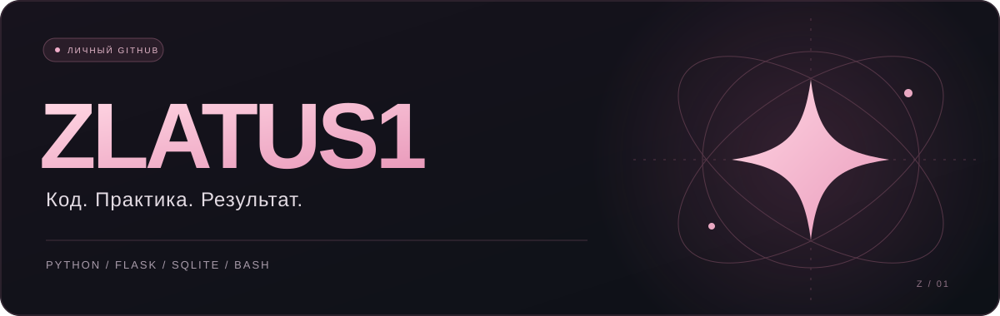

  

  
  
  

### Привет, я Zlatus1

Здесь собираю учебные проекты и практические работы: от приложений на Python до тестирования в Linux. Пишу код, проверяю, как он работает, и сохраняю результаты.

 

### Технологии

  
  
  
  
  
  
  

 

### Мои работы

| Проект | Что внутри | Технологии |
| :--- | :--- | :--- |
| [**PROJECTZLATA ↗**](https://github.com/zlatus1/PROJECTZLATA) | Практические работы с базой данных, консольным CRUD и маршрутами веб-приложения. | Python · Flask · SQLite |
| [**zlata ↗**](https://github.com/zlatus1/zlata) | Пять заданий по тестированию в Linux: окружение, ОС, HTTP, порты и конфигурации. Скрипты и результаты запусков. | Bash · Linux · curl |

 

  Написать → Проверить → Разобраться → Улучшить

